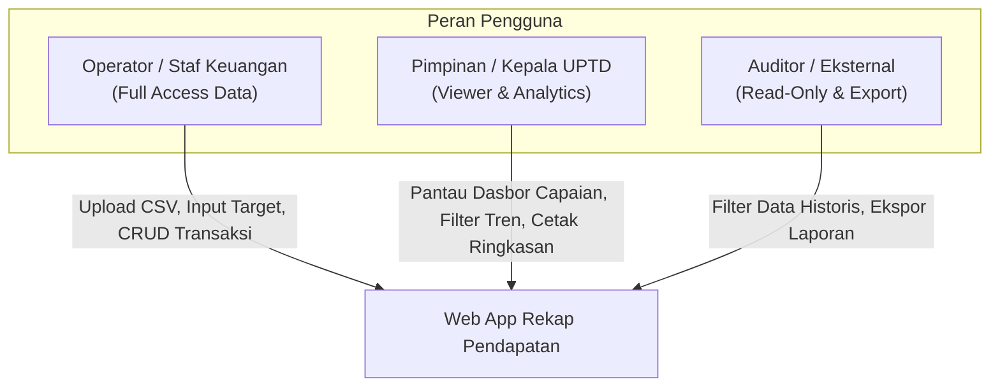
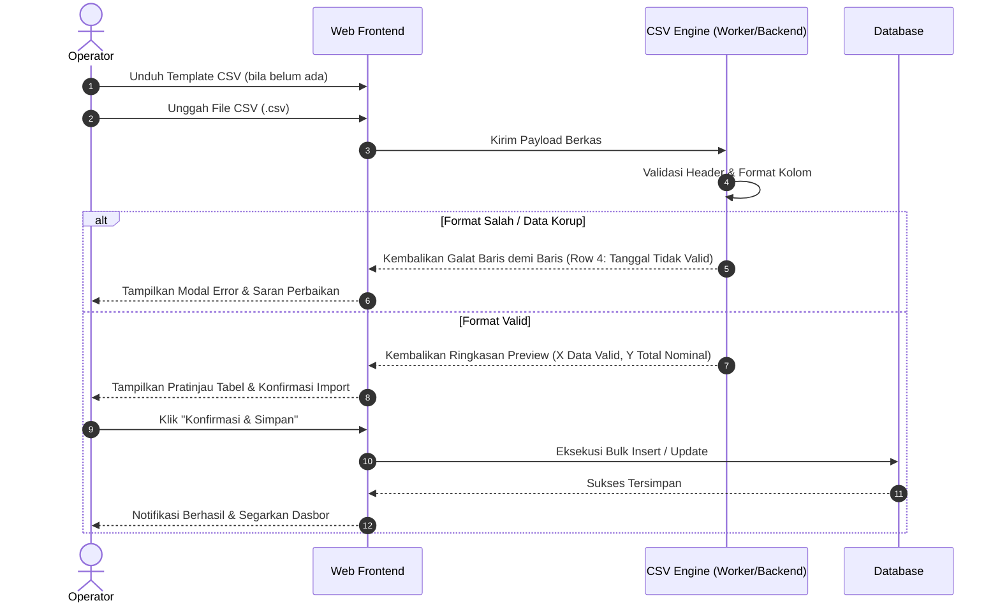
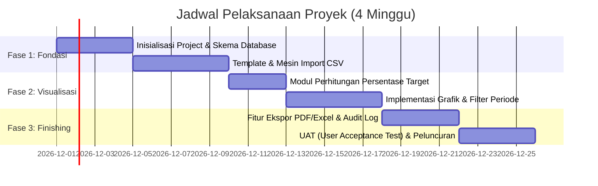

# Product Requirement Document (PRD)
## Web App Rekapitulasi & Pelaporan Pendapatan (Revenue Recapitulation & Reporting System)

---

| Atribut | Detail |
| :--- | :--- |
| **Nama Proyek** | Sistem Informasi Rekapitulasi & Pelaporan Pendapatan (SIP-Pendapatan) |
| **Versi Dokumen** | 1.0.0 |
| **Status** | Draf Disetujui / Siap Implementasi |
| **Target Rilis** | Q1 / Tahap MVP |

---

## 1. Ringkasan Eksekutif & Latar Belakang

### 1.1 Latar Belakang
Pengelolaan dan pemantauan realisasi pendapatan (seperti retribusi daerah, pendapatan operasional, atau pos penerimaan lainnya) sering kali menghadapi kendala rekonsiliasi manual yang lambat dan rentan inkonsistensi data. Manajemen membutuhkan pemantauan berkala secara langsung untuk mengukur:
1. Seberapa besar realisasi pendapatan telah tercapai dibandingkan target yang ditetapkan (dalam persentase dan nominal).
2. Tren penerimaan berdasarkan dimensi waktu (harian, bulanan, tahunan).
3. Kemudahan penginputan data massal tanpa perlu input entri satu per satu melalui formulir yang repetitif.

### 1.2 Tujuan Produk
1. **Transparansi Capaian Target**: Menyajikan indikator visual interaktif (persentase realisasi vs target) secara real-time.
2. **Analisis Fleksibel**: Menyediakan penyaringan data dinamis (harian/tanggal, bulanan, tahunan, hingga rentang waktu kustom).
3. **Efisiensi Entri Data**: Memfasilitasi mekanisme import data transaksi berbasis CSV dengan validasi otomatis dan pelaporan galat (error report).
4. **Pengambilan Keputusan Cepat**: Memfasilitasi pimpinan dengan dasbor visual yang siap cetak/ekspor ke PDF dan Excel.

---

## 2. Pengguna & Persona (User Roles)



| Peran | Tanggung Jawab Utama | Akses Fitur |
| :--- | :--- | :--- |
| **Staf Keuangan / Operator** | Upload CSV transaksi harian, koreksi anomali data, mengelola target periode. | Dasbor, Import CSV, Input Manual, Manajemen Target, Ekspor. |
| **Pimpinan / Kepala UPTD** | Meninjau performa capaian target, mengevaluasi tren pendapatan musiman. | Dasbor Visualisasi, Filtering Periode, Ringkasan Eksekutif, Cetak Laporan. |
| **Viewer / Auditor** | Memvalidasi akurasi data masa lalu dan kepatuhan pencatatan. | Read-Only Dasbor, Filtering Tanggal, Ekspor Data Mentah/Rekap. |

---

## 3. Ruang Lingkup Produk (Scope of Work)

### 3.1 In-Scope (Fase MVP)
- Dasbor metrik utama (Total Realisasi, Target Periode, Deviasi/Selisih, Persentase Capaian).
- Visualisasi grafik:
  - *Radial Gauge / Progress Bar* untuk persentase capaian target.
  - *Bar/Line Chart* tren pendapatan vs garis batas target (time series).
  - *Donut Chart* kontribusi penerimaan per kategori/pos pendapatan.
- Filtering data:
  - Presets: Hari Ini, Bulan Ini, Tahun Ini.
  - Mode Pemilihan: Filter per Tanggal Spesifik, Filter per Bulan (Jan-Des), Filter per Tahun.
  - Kustom: Rentang tanggal awal hingga akhir (Date Range Picker).
- Mesin Import CSV:
  - Upload file CSV (drag-and-drop / file browser).
  - Validasi header, tipe data, dan format tanggal otomatis.
  - Preview data sebelum komit ke database.
  - Unduhan template CSV resmi.
- Ekspor laporan (Excel `.xlsx` dan PDF ringkasan).

### 3.2 Out-of-Scope (Fase Lanjutan)
- Integrasi otomatis langsung ke payment gateway perbankan / EDC real-time.
- Multi-currency (hanya mendukung format mata uang Rupiah / IDR).
- Modul akuntansi ganda (*double-entry bookkeeping* jurnal umum).

---

## 4. Kebutuhan Fungsional (Functional Requirements)

### 4.1 Modul Dasbor & Visualisasi Capaian Target

| ID | Kebutuhan Fungsional | Kriteria Penerimaan (Acceptance Criteria) |
| :--- | :--- | :--- |
| **FR-DSH-01** | Indikator Persentase Target | Menampilkan persentase pencapaian dengan formula: `(Total Realisasi / Target Nominal) * 100%`. Ditampilkan dalam bentuk kartu metrik besar dan grafik *Progress Gauge*. |
| **FR-DSH-02** | Indikator Status Warna | - `< 50%`: Merah (Perhatian)<br/>- `50% - 84%`: Kuning/Oranye (Berjalan)<br/>- `85% - 99%`: Biru (Mendekati Target)<br/>- `>= 100%`: Hijau (Target Tercapai/Surplus). |
| **FR-DSH-03** | Grafik Tren Pendapatan | Menampilkan *Dual-axis Bar & Line Chart*:<br/>- Sumbu X: Hari / Bulan sesuai filter aktif.<br/>- Sumbu Y1: Nominal Realisasi harian/bulanan.<br/>- Sumbu Y2 / Reference Line: Target proporsional. |
| **FR-DSH-04** | Breakdown Kategori | Menampilkan komposisi penerimaan berdasarkan pos retribusi/kategori dalam diagram lingkaran (*Pie/Donut Chart*) dan tabel peringkat kontribusi. |

### 4.2 Modul Penyaringan Data (Filtering)

| ID | Kebutuhan Fungsional | Kriteria Penerimaan |
| :--- | :--- | :--- |
| **FR-FLT-01** | Filter Dimensi Waktu | Pengguna dapat memilih filter dengan toggle cepat:<br/>1. **Harian**: Pemilih tanggal (*Single Date Picker*).<br/>2. **Bulanan**: Pilihan Bulan (1-12) dan Tahun terkait.<br/>3. **Tahunan**: Pilihan Tahun (misal: 2024, 2025, 2026).<br/>4. **Rentang Bebas**: Tanggal Mulai s/d Tanggal Selesai. |
| **FR-FLT-02** | Filter Berjenjang | Filter waktu dapat dikombinasikan dengan filter kategori pos pendapatan atau unit kerja. |
| **FR-FLT-03** | Responsivitas Filter | Perubahan filter langsung memutakhirkan seluruh visualisasi kartu dan grafik dalam waktu `< 1 detik` tanpa reload halaman penuh (SPA State). |

### 4.3 Modul Import Data CSV



| ID | Kebutuhan Fungsional | Kriteria Penerimaan |
| :--- | :--- | :--- |
| **FR-IMP-01** | Template CSV Standar | Menyediakan tombol "Unduh Template CSV" yang berisi baris header baku dan 2 contoh data pengisian yang benar. |
| **FR-IMP-02** | Validasi Format & Struktur | Memvalidasi keberadaan header wajib, format tanggal (`YYYY-MM-DD` atau `DD/MM/YYYY`), dan tipe angka desimal/bulat untuk nominal. |
| **FR-IMP-03** | Penanganan Kesalahan Baris | Jika terdapat galat, sistem memetakan baris spesifik (misal: "Baris 12: Nominal bukan angka") tanpa merusak data lain. |
| **FR-IMP-04** | Opsi Duplikasi Data | Pengguna dapat memilih aksi saat ditemukan transaksi dengan ID/nomor referensi yang sama: *Skip* (Lewati) atau *Overwrite* (Perbarui). |
| **FR-IMP-05** | Riwayat Import (Audit Log) | Mencatat waktu upload, nama file, jumlah baris berhasil, dan nama staf yang mengunggah. |

### 4.4 Format Skema Kolom CSV Standar

Berkas CSV wajib menggunakan pembatas koma (`,`) atau titik-koma (`;`), dengan struktur kolom berikut:

| Nama Kolom Header | Wajib? | Tipe Data | Format / Contoh | Keterangan |
| :--- | :--- | :--- | :--- | :--- |
| `tanggal` | Ya | Tanggal | `2026-11-25` | Tanggal transaksi penerimaan |
| `kode_rekening` / `kode_pos` | Ya | String | `4.1.2.01.01` | Kode klasifikasi pos retribusi/pendapatan |
| `nama_kategori` | Ya | String | `Retribusi Kebersihan` | Nama pengelompokan pendapatan |
| `uraian_transaksi` | Tidak | String | `Pembayaran Pelanggan Sektor A` | Catatan/keterangan transaksi |
| `nominal` | Ya | Numerik | `1500000` | Nilai penerimaan bersih dalam angka polos tanpa simbol |
| `nomor_bukti` | Tidak | String | `BKT-202611-0091` | Nomor kuitansi / STS / referensi bayar |

---

## 5. Kebutuhan Non-Fungsional (Non-Functional Requirements)

1. **Performa**:
   - Dasbor pertama kali dimuat (*First Contentful Paint*) `< 1.8 detik`.
   - Proses parsing CSV hingga 10.000 baris selesai dalam `< 3 detik` di sisi klien/server.
2. **Keamanan (Security)**:
   - Sanitasi file saat upload guna mencegah *CSV Injection* (`=CMD()`, `@SUM()`).
   - Autentikasi berbasis token (JWT atau session cookies aman).
   - Hak akses berbasis peran (Role-Based Access Control / RBAC).
3. **Penyimpanan & Keandalan**:
   - Dukungan transaksi database berbasis *atomic operation* (rollback otomatis jika proses batch import dibatalkan di tengah jalan).
4. **Antarmuka (Usability)**:
   - Desain responsif, nyaman diakses melalui laptop staf kantor maupun tablet pimpinan saat inspeksi lapangan.
   - Angka keuangan diformat otomatis menggunakan lokalisasi Indonesia (contoh: `Rp 125.500.000`).

---

## 6. Desain Antarmuka & Tata Letak Layar (Wireframe Conceptual Layout)

```
+-----------------------------------------------------------------------------------------+
| [LOGO] SIP-PENDAPATAN UPTD              [Filter: Tahun 2026 v] [Bulan: Nov v] [Admin v] |
+-----------------------------------------------------------------------------------------+
| [ Tombol: + Import Data CSV ]  [ Tombol: Unduh Template ]  [ Tombol: Cetak Laporan ]   |
+-----------------------------------------------------------------------------------------+
| KARTU RINGKASAN                                                                         |
| +-------------------+ +-------------------+ +-------------------+ +-------------------+ |
| | Target Periode    | | Total Realisasi   | | Persentase        | | Sisa Target / Dev | |
| | Rp 1.500.000.000  | | Rp 1.275.000.000  | | 85.0 % [OK]       | | Rp 225.000.000    | |
| +-------------------+ +-------------------+ +-------------------+ +-------------------+ |
+-----------------------------------------------------------------------------------------+
| GRAFIK UTAMA                                                                            |
| +-----------------------------------------------------+ +-----------------------------+ |
| | Tren Pendapatan Harian / Bulanan vs Garis Target    | | Capaian per Kategori        | |
| | [ Grafik Batang Realisasi & Garis Target Ambang ]   | | [ Donut Chart Kategori ]    | |
| +-----------------------------------------------------+ +-----------------------------+ |
+-----------------------------------------------------------------------------------------+
| TABEL RINCIAN TRANSAKSI TERBARU                                                         |
| Tanggal    | No Bukti    | Kategori               | Uraian             | Nominal        |
| 2026-11-25 | BKT-001     | Retribusi Pelayanan    | Pembayaran Jasa    | Rp  15.000.000 |
| 2026-11-24 | BKT-002     | Sewa Fasilitas         | Sewa Aula Bln Nov  | Rp  30.000.000 |
+-----------------------------------------------------------------------------------------+
```

---

## 7. Rekomendasi Arsitektur & Teknologi

- **Frontend**:
  - Framework: Next.js (React) / Vite + React + Tailwind CSS
  - Library Grafik: **Recharts** atau **ApexCharts** (interaktif, tooltip kaya, mudah membuat target reference lines)
  - CSV Parser: **PapaParse** (cepat, mendukung pemrosesan baris demi baris di sisi browser sebelum dikirim)
- **Backend & Database**:
  - API: Node.js (Next.js App Router / Express) atau Python (FastAPI)
  - Database: PostgreSQL / MySQL (cocok untuk agregasi data analitik relasional seperti `SUM()`, `GROUP BY`)
  - ORM: Prisma / Drizzle ORM
- **Export Utility**:
  - Excel: `xlsx` / `exceljs`
  - PDF: `@react-pdf/renderer` atau `jspdf-autotable`

---

## 8. Rencana Implementasi & Milestone



| Minggu | Fokus Pekerjaan | Output Kunci |
| :--- | :--- | :--- |
| **Minggu 1** | Basis data, skema transaksi, formulir target pendapatan, modul parser CSV. | Fitur upload CSV berhasil membaca dan menyimpan data ke database. |
| **Minggu 2** | Pembuatan komponen filter (hari/bulan/tahun) dan engine kalkulasi capaian. | Dashboard cards dengan persentase realisasi vs target berfungsi dinamis. |
| **Minggu 3** | Pemasangan chart visual (Bar, Line, Gauge, Donut) & tabel detail transaksi. | Dashboard visualisasi lengkap dengan interaksi filter waktu. |
| **Minggu 4** | Ekspor laporan PDF/Excel, optimasi keamanan CSV, UAT, dan deployment. | Aplikasi siap digunakan secara penuh oleh staf dan pimpinan. |
